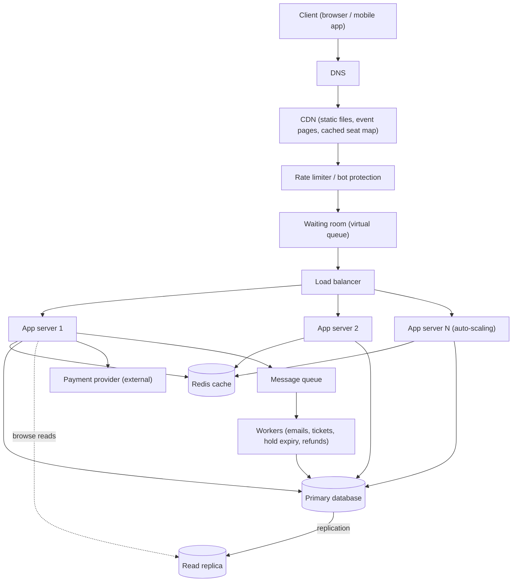

# TicketHub Design Document

TicketHub is a website that sells tickets for concerts and events. This document follows the six-part framework: requirements, estimates, API, data model, architecture and trade-offs. It also explains how the design stops two people from buying the same seat.

## 1. Requirements

### Functional
- Users can register and log in.
- Users can browse and search events (by name, date, city).
- Users can view the seat map of an event and see which seats are available.
- Users can hold seats for a short time (5 minutes) while they pay.
- Users can pay for held seats and receive their tickets by email.
- Users can see their purchased tickets.
- Users can release seats they no longer want.

### Non-functional
- **Correctness (most important):** a seat is never sold twice, and a user is never charged for a seat they do not get.
- **Fairness:** first come, first served. Each user can hold at most 6 seats, and bots are slowed down by rate limits and a waiting room.
- **Speed:** browsing pages respond in under 300 ms; seat holds respond in under 500 ms, even during a big sale.
- **Availability during big sales:** the site must stay up when 200,000 people arrive at once. Slowing users down in a controlled way is acceptable; crashing is not.
- **Durability:** a paid ticket is never lost.
- **Security:** HTTPS, hashed passwords, and card details handled only by an external payment provider.

## 2. Estimates

### Normal day
| Metric | Calculation | Result |
|--------|-------------|--------|
| Page views per day | 50,000 visitors x 10 pages | 500,000 |
| Page views per second (average) | 500,000 / 86,400 | about 6/s |
| Page views per second (busy hour, 5x) | 6 x 5 | about 30/s |
| Tickets sold per day | given | 5,000 |
| Purchases per second (average) | 5,000 / 86,400 | about 0.06/s |
| Purchases per second (busy hour, 10x) | 0.06 x 10 | about 0.6/s |
| Storage per year | 5,000 x 365 = 1.8 million tickets x 1 KB | under 2 GB |

A normal day is tiny: one small server could handle it.

### Big sale (200,000 people, 20,000 seats, first 10 minutes)
| Metric | Calculation | Result |
|--------|-------------|--------|
| Arrival rate | 200,000 / 600 seconds | about 333 users/s |
| Requests per second | each user makes about 10 requests (event page, seat map refreshes, hold, pay); 200,000 x 10 / 600 | about 3,300/s on average |
| Requests per second at the very start (3x) | 3,300 x 3 | about 10,000/s |
| Seat hold attempts | every user tries at least once: 200,000 / 600 | about 333/s on average, over 1,000/s in the first minute |
| Successful sales | 20,000 / 600 | about 33/s |
| Competition per seat | 200,000 / 20,000 | 10 people want each seat |

### Comparison
| | Normal day | Big sale | Increase |
|---|-----------|----------|----------|
| Page requests per second | about 6 | about 3,300 | about 550 times |
| Purchases per second | about 0.06 | about 33 | about 550 times |

The big sale is roughly **550 times** busier than a normal day, and it lasts only 10 minutes. This is why we cannot design for the average day: we design for the spike. Also, 9 out of 10 users will fail to get a seat, so the system must handle failure politely and quickly.

## 3. API

Base URL: `https://api.tickethub.example/v1`. JSON format. `Authorization: Bearer <token>` is required except for browsing events.

| # | Method | Path | Description | Success status |
|---|--------|------|-------------|----------------|
| 1 | GET | `/events` | List and search events (`?city=&date=&page=`) | 200 OK |
| 2 | GET | `/events/{id}` | Details of one event | 200 OK |
| 3 | GET | `/events/{id}/seats` | Seat map with each seat's status (available, held, sold) | 200 OK |
| 4 | POST | `/events/{id}/holds` | Hold one or more seats for 5 minutes | 201 Created |
| 5 | DELETE | `/holds/{holdId}` | Release held seats | 204 No Content |
| 6 | POST | `/orders` | Pay for a hold and create the order | 201 Created |
| 7 | GET | `/me/tickets` | List my purchased tickets | 200 OK |

### Hold seats: `POST /events/12/holds`
Request:
```json
{ "seat_ids": [501, 502] }
```
Response `201 Created`:
```json
{
  "hold_id": "h_8f3a",
  "event_id": 12,
  "seat_ids": [501, 502],
  "expires_at": "2026-10-25T18:05:00Z"
}
```

### Pay: `POST /orders`
Header: `Idempotency-Key: 7c1e...` (prevents charging twice if the request is repeated).
```json
{ "hold_id": "h_8f3a", "payment_token": "tok_visa_123" }
```
Response `201 Created`:
```json
{ "order_id": 9001, "status": "paid", "tickets": [{ "ticket_id": 7001, "seat_id": 501 }, { "ticket_id": 7002, "seat_id": 502 }] }
```

### Errors
| Status | When |
|--------|------|
| 400 Bad Request | Invalid input (for example more than 6 seats) |
| 401 Unauthorized | Missing or invalid token |
| 402 Payment Required | Payment was declined |
| 404 Not Found | Event, hold or order does not exist |
| 409 Conflict | **Seat already held or sold by someone else** |
| 410 Gone | The hold has expired |
| 429 Too Many Requests | Rate limit exceeded |
| 503 Service Unavailable | Waiting room is full; retry later (with a `Retry-After` header) |

Error body:
```json
{ "error": { "code": "SEAT_TAKEN", "message": "Seat 501 is no longer available", "status": 409 } }
```

## 4. Data model

### Tables
- **users**: `id` (PK), `email` (unique), `password_hash`, `created_at`
- **events**: `id` (PK), `name`, `venue`, `city`, `starts_at`, `on_sale_at`
- **seats**: `id` (PK), `event_id` (FK to events), `section`, `row_label`, `seat_number`, `price_cents`, `status` (`available`, `held`, `sold`), `held_by` (FK to users, nullable), `hold_expires_at` (nullable). **Unique** on (`event_id`, `section`, `row_label`, `seat_number`).
- **orders**: `id` (PK), `user_id` (FK to users), `event_id` (FK to events), `total_cents`, `status` (`paid`, `refunded`), `idempotency_key` (unique), `created_at`
- **tickets**: `id` (PK), `order_id` (FK to orders), `seat_id` (FK to seats), **unique on `seat_id`**

### Relationships
- **One-to-many:** one user has many orders; one event has many seats; one order has many tickets.
- **One-to-one (enforced by constraint):** one seat can have at most one ticket, because `tickets.seat_id` is unique.
- **Many-to-many:** users and events are connected through orders, since a user can buy for many events and an event has many buyers.

### SQL
```sql
CREATE TABLE users (
  id BIGINT PRIMARY KEY AUTO_INCREMENT,
  email VARCHAR(255) NOT NULL UNIQUE,
  password_hash VARCHAR(255) NOT NULL,
  created_at TIMESTAMP NOT NULL DEFAULT CURRENT_TIMESTAMP
);

CREATE TABLE events (
  id BIGINT PRIMARY KEY AUTO_INCREMENT,
  name VARCHAR(200) NOT NULL,
  venue VARCHAR(200) NOT NULL,
  city VARCHAR(100) NOT NULL,
  starts_at TIMESTAMP NOT NULL,
  on_sale_at TIMESTAMP NOT NULL
);

CREATE TABLE seats (
  id BIGINT PRIMARY KEY AUTO_INCREMENT,
  event_id BIGINT NOT NULL,
  section VARCHAR(20) NOT NULL,
  row_label VARCHAR(10) NOT NULL,
  seat_number INT NOT NULL,
  price_cents INT NOT NULL,
  status VARCHAR(10) NOT NULL DEFAULT 'available',
  held_by BIGINT NULL,
  hold_expires_at TIMESTAMP NULL,
  UNIQUE (event_id, section, row_label, seat_number),
  FOREIGN KEY (event_id) REFERENCES events(id),
  FOREIGN KEY (held_by) REFERENCES users(id)
);

CREATE TABLE orders (
  id BIGINT PRIMARY KEY AUTO_INCREMENT,
  user_id BIGINT NOT NULL,
  event_id BIGINT NOT NULL,
  total_cents INT NOT NULL,
  status VARCHAR(10) NOT NULL,
  idempotency_key VARCHAR(64) NOT NULL UNIQUE,
  created_at TIMESTAMP NOT NULL DEFAULT CURRENT_TIMESTAMP,
  FOREIGN KEY (user_id) REFERENCES users(id),
  FOREIGN KEY (event_id) REFERENCES events(id)
);

CREATE TABLE tickets (
  id BIGINT PRIMARY KEY AUTO_INCREMENT,
  order_id BIGINT NOT NULL,
  seat_id BIGINT NOT NULL UNIQUE,
  FOREIGN KEY (order_id) REFERENCES orders(id),
  FOREIGN KEY (seat_id) REFERENCES seats(id)
);

CREATE INDEX idx_seats_event_status ON seats (event_id, status);
```
The index on `seats (event_id, status)` makes "show available seats for this event" fast.

## 5. Preventing two people from buying the same seat

The danger is a **race condition**. If the app first checks "is the seat free?" and then writes "it is mine", two requests can both pass the check at the same moment and both succeed. So the check and the change must be a single atomic step inside the database. The design has three layers.

**Layer 1: an atomic hold.** Holding a seat is one SQL statement, not a check followed by an update:
```sql
UPDATE seats
SET status = 'held', held_by = :user_id,
    hold_expires_at = NOW() + INTERVAL 5 MINUTE
WHERE id = :seat_id
  AND (status = 'available'
       OR (status = 'held' AND hold_expires_at < NOW()));
```
The database locks the seat's row while it runs, so if two users try at the same instant, one update runs first and the second finds the seat no longer matches the `WHERE` clause. The app reads the number of rows changed: **1 means you got the seat; 0 means someone else did**, and the API returns `409 Conflict`. If a user asks for several seats, all the updates run in one transaction, so they either get every seat or none (the transaction rolls back).

**Layer 2: a transaction when paying.** After the payment provider confirms the charge, one transaction runs:
1. `SELECT ... FROM seats WHERE id IN (...) FOR UPDATE` to lock the rows.
2. Check that each seat is still held by this user and the hold has not expired.
3. Set the seats to `sold`, insert the order and the tickets.
4. `COMMIT`.

If the check fails (for example the hold expired and another user took the seat), the transaction rolls back and the payment is refunded automatically. An `Idempotency-Key` stops a repeated request from charging or selling twice.

**Layer 3: a database constraint as the final safety net.** `tickets.seat_id` is `UNIQUE`. Even if there were a bug in the application code, the database would reject a second ticket for the same seat. Correctness does not depend on the app being perfect.

**Expired holds:** a background worker runs every few seconds and sets expired holds back to `available`, so abandoned seats return to sale.

## 6. Architecture



### What each component does
- **Client:** the browser or app where users browse events and buy tickets.
- **DNS:** sends users to the CDN and our servers by name.
- **CDN:** serves images, scripts and event pages from places near users, and caches the seat map for 1 to 2 seconds, so most of the 3,300 requests per second never reach our servers.
- **Rate limiter / bot protection:** limits requests per user and IP so bots cannot grab seats before real people.
- **Waiting room:** during a big sale it lets users in at a controlled speed (for example 500 per second) in a fair, first-come order, so the buying system is never overloaded.
- **Load balancer:** spreads requests across the app servers and removes any server that fails.
- **App servers (auto-scaling):** stateless servers that run the API; extra servers start automatically before and during a sale.
- **Redis cache:** keeps event details and the seat map in memory, and stores waiting-room positions and rate-limit counters, so the database is not asked the same question thousands of times.
- **Primary database:** the single source of truth; all holds and sales go through it, using the transactions and constraints described above.
- **Read replica:** serves browsing queries (events, search), keeping the primary free for holds and payments.
- **Payment provider:** an external service that handles card details, so we never store them.
- **Message queue and workers:** do slow jobs outside the user's request: confirmation emails, ticket generation, releasing expired holds, and refunds.

### How it survives the big sale
1. **Before the sale:** extra app servers are started in advance, event data is cached, and the seat map is pre-loaded.
2. **At the start:** the CDN absorbs the static and cached traffic; the rate limiter removes bots; the waiting room turns a spike of 200,000 arrivals into a steady flow the servers can handle.
3. **During the sale:** only the small number of hold and payment requests reach the primary database, and those use short, atomic statements. Failed attempts (the 9 out of 10 who lose) get a fast `409` and the seat map refreshes.
4. **Slow work is moved away:** emails and tickets go through the queue, so paying is fast even if the email system is slow.
5. **If something is overloaded:** the system returns `503` with a `Retry-After` header rather than crashing, and the database is protected.

**Single points of failure:** the load balancer, cache and database each have a standby or replica; app servers and workers run in several copies in different zones; the primary database fails over to the replica.

## 7. Trade-offs

1. **Fairness and protection vs convenience (waiting room).** The waiting room keeps the system alive and fair, but some users wait several minutes and may leave. Without it, the site could crash and nobody could buy. We accept the wait.
2. **Hold time: 5 minutes.** A longer hold gives people time to pay but locks seats away from others, and a short hold releases seats faster but makes slow payers lose them. Five minutes is a compromise; abandoned seats return to sale automatically.
3. **Cached seat map: speed vs freshness.** A seat map cached for 1 to 2 seconds cuts traffic massively but may show a seat as available when it was just taken. We accept this because the hold step is the authority: the user simply gets a `409` and picks another seat.
4. **Strong consistency in one database vs scaling.** Keeping seats in one primary database with transactions guarantees correctness but all writes go to one machine. At about 1,000 hold attempts per second at the peak this is fine; the plan if it grows is to give each big event its own database partition (sharding by `event_id`).